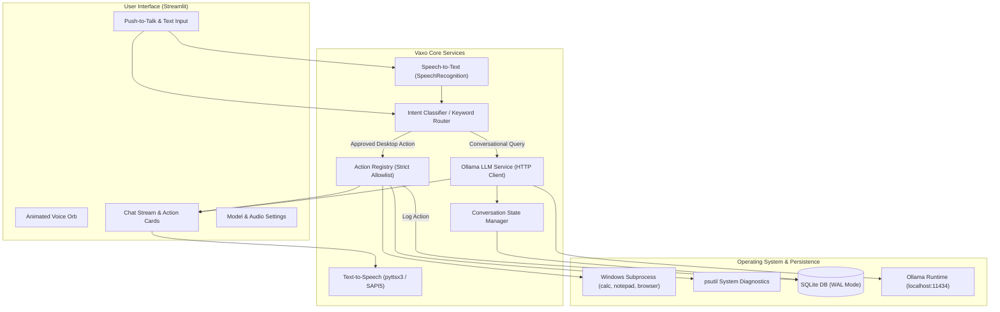

# 🔮 Vaxo — Local Voice AI & Desktop Automation Agent

[](https://www.python.org/)
[](https://streamlit.io/)
[](https://ollama.ai/)
[](https://opensource.org/licenses/MIT)
[]()

> **Vaxo** is a production-grade, local-first voice AI and desktop automation assistant designed for Windows. It executes approved system tasks, speaks responses aloud using offline text-to-speech, and performs language reasoning using a locally hosted open-source LLM via Ollama — all without recurring cloud API fees or private data leakage.

---

## 📑 Table of Contents

1. [Project Overview](#-project-overview)
2. [Key Features](#-key-features)
3. [Architecture & Data Flow](#-architecture--data-flow)
4. [Technology Stack](#-technology-stack)
5. [Prerequisites & System Requirements](#-prerequisites--system-requirements)
6. [Step-by-Step Installation](#-step-by-step-installation)
7. [Ollama & Local Model Setup](#-ollama--local-model-setup)
8. [How to Launch & Use Vaxo](#-how-to-launch--use-vaxo)
9. [Supported Commands & Actions](#-supported-commands--actions)
10. [Automated Testing & Verification](#-automated-testing--verification)
11. [Security Architecture & Defensive Design](#-security-architecture--defensive-design)
12. [Troubleshooting Guide](#-troubleshooting-guide)
13. [Deployment Options](#-deployment-options)
14. [Portfolio & Interview Guide (MCA / SDE)](#-portfolio--interview-guide-mca--sde)
15. [Resume Entry Template](#-resume-entry-template)

---

## 🌟 Project Overview

Modern AI assistants typically depend on centralized cloud APIs (OpenAI, Anthropic), creating ongoing subscription costs, vendor lock-in, and privacy vulnerabilities when operating on personal computers.

**Vaxo** solves this by establishing a **local-first, secure architecture**:
- **100% Private Language Inference:** Uses **Ollama** running locally on the CPU/GPU.
- **Offline Text-to-Speech:** Uses Windows native speech synthesis (SAPI5 via `pyttsx3`) without network transmission.
- **Strictly Allowlisted Automation:** Eliminates prompt-injection and arbitrary code execution hazards by routing intents through an immutable action registry.
- **Persistent State:** Uses SQLite in WAL (Write-Ahead Logging) mode to preserve conversations and audit logs.

---

## ✨ Key Features

- **🎙️ Push-to-Talk Voice Interaction:** One-click voice input with visual ambient feedback and speech-to-text conversion.
- **🔊 Offline Neural Speech Output:** Clean, synthesized audio replies with configurable speed, volume, and voice selection.
- **🛡️ Strict Action Allowlist:** Pre-approved desktop controls (Calculator, Notepad, Browser, System Diagnostics, Time/Date) mapped using robust keyword matching.
- **🤖 Modular Local LLM Service:** Connects to Ollama with automatic heartbeat detection, model switching, timeout guards, and user-friendly offline fallbacks.
- **🧪 Interactive Portfolio Demo Mode:** Enables recruiters and reviewers to evaluate UI responsiveness and simulated AI flows without installing Ollama.
- **📜 Session & Action Auditing:** Persistent conversation storage, session restoration, and execution audit logging.
- **🎨 Premium Futuristic Dark UI:** Custom CSS with an animated glowing voice orb, responsive status pills, and dark navy/violet aesthetics.

---

## 🏛️ Architecture & Data Flow

### Architecture Diagram (Mermaid)



### Data Flow Lifecycle

1. **Input Ingestion:** The user speaks (Push-to-Talk) or types a command.
2. **Intent Classification:**
   - Input is evaluated against the `ActionRegistry` keywords.
   - If an approved action matches (e.g., *"open calculator"* or *"system info"*), it executes via `windows_actions.py`.
   - If no system action matches, the query is dispatched to `llm_service.py`.
3. **Local Inference:** `VaxoLLM` streams context and history to the local Ollama instance (`/api/chat`).
4. **Persistence & Speech:** The response is persisted in SQLite, displayed on the chat stream, and optionally voiced aloud via `TextToSpeechService`.

---

## 🛠️ Technology Stack

| Layer | Technology | Version | Purpose |
|---|---|---|---|
| **Core Language** | Python | 3.12+ | Primary application runtime |
| **Frontend UI** | Streamlit | >=1.38.0 | Reactive desktop-accessible web interface |
| **Local LLM Runtime** | Ollama | Latest | Local model execution (`tinyllama`, `phi3:mini`) |
| **Speech Recognition** | SpeechRecognition | >=3.10.0 | Audio recording and transcription |
| **Speech Synthesis** | pyttsx3 | >=2.90 | Offline text-to-speech via SAPI5 |
| **System Diagnostics** | psutil | >=5.9.0 | Real-time CPU, RAM, disk, and uptime metrics |
| **Database** | SQLite3 | Native | Zero-config persistent conversation and audit logging |
| **Testing** | pytest | >=7.4.0 | Unit, integration, and security test automation |

---

## 💻 Prerequisites & System Requirements

- **Operating System:** Windows 10 or Windows 11 (64-bit).
- **Python Version:** Python 3.11 or 3.12 (with pip and virtualenv support).
- **RAM:** Minimum 8 GB (for running lightweight local models such as `tinyllama` or `qwen2:0.5b`).
- **Disk Space:** ~2 GB for Python environment and ~1.5 GB per local LLM model.
- **Audio:** Microphone (optional for voice input) and speakers/headphones for voice output.

---

## 🚀 Step-by-Step Installation

### 1. Clone or Open the Repository
```powershell
cd "c:\Users\sagni\OneDrive\Desktop\Vaxo Local Agent"
```

### 2. Set Up a Virtual Environment
```powershell
python -m venv venv
.\venv\Scripts\activate
```

### 3. Install Dependencies
```powershell
pip install -r requirements.txt
```

*(Optional: For direct microphone recording, ensure PyAudio is installed. On Windows: `pip install pipwin; pipwin install pyaudio` or install a pre-compiled wheel).*

### 4. Configure Environment Variables
Copy `.env.example` to `.env`:
```powershell
copy .env.example .env
```

---

## 🦙 Ollama & Local Model Setup

Vaxo is powered by [Ollama](https://ollama.ai) for 100% private local language processing.

### 1. Install Ollama
Download and run the Windows installer from [https://ollama.ai/download](https://ollama.ai/download).

### 2. Pull a Lightweight Model
For systems with 8 GB RAM and integrated GPUs, lightweight models provide fast inference without RAM exhaustion:

```powershell
# Recommended for 8GB RAM (Fastest, ~1.1GB size)
ollama pull tinyllama

# Alternative lightweight model (~400MB size)
ollama pull qwen2:0.5b

# For 16GB+ RAM systems (Higher reasoning quality, ~2.3GB size)
ollama pull phi3:mini
```

### 3. Verify Ollama Service
Ensure Ollama is running:
```powershell
curl http://localhost:11434/api/tags
```

---

## 🖥️ How to Launch & Use Vaxo

### Option 1: One-Click Windows Launch Script (Recommended)
Double-click `start_vaxo.bat` in the project root or execute:
```powershell
.\start_vaxo.bat
```

### Option 2: Manual Terminal Launch
```powershell
.\venv\Scripts\activate
streamlit run app.py
```
Open your browser at **`http://localhost:8501`**.

---

## ⚡ Supported Commands & Actions

Vaxo enforces a zero-trust model: only explicitly registered actions can be triggered.

| Action Name | Voice / Typed Trigger Phrases | Behavior & Security Boundary |
|---|---|---|
| **Open Calculator** | *"open calculator"*, *"calc"*, *"open calc"* | Launches Windows `calc.exe` with `CREATE_NO_WINDOW` flag |
| **Open Notepad** | *"open notepad"*, *"text editor"*, *"open editor"* | Launches `notepad.exe` |
| **Open Browser** | *"open browser"*, *"internet"*, *"open chrome"* | Opens default browser; strictly validates `http://` and `https://` schemas |
| **Current Time & Date** | *"what time is it"*, *"current time"*, *"what date"* | Formats localized system clock (`strftime`) |
| **System Diagnostics** | *"system info"*, *"cpu usage"*, *"ram status"* | Collects live CPU, RAM, disk, and boot time using `psutil` |
| **Stop Voice** | *"stop listening"*, *"mute"*, *"be quiet"* | Disables TTS speech output and resets voice state |
| **Show History** | *"show history"*, *"conversation history"* | Navigates to conversation and action audit log |
| **AI Conversational Chat** | Any general knowledge or question | Processed by local Ollama LLM |

---

## 🧪 Automated Testing & Verification

Vaxo includes a comprehensive test suite covering 83 test scenarios.

### Run All Unit & Security Tests
```powershell
.\venv\Scripts\python.exe -m pytest tests\ -v
```

### Test Coverage Highlights
- ✅ **`test_action_registry.py`**: Tests registration, execution, argument passing, error handling, and keyword routing.
- ✅ **`test_validation.py`**: AST-level security verification ensuring no `shell=True` subprocess calls exist; validates URL scheme sanitization and rejects unauthorized command injections.
- ✅ **`test_conversation.py`**: SQLite database initialization, transaction isolation, message persistence, context window slicing, and audit logging.
- ✅ **`test_llm_service.py`**: Mocked connection dropouts, timeout handling, model 404 detection, and Demo Mode simulation fallbacks.

---

## 🛡️ Security Architecture & Defensive Design

1. **No Arbitrary Shell Execution:**
   - Vaxo **never** invokes `shell=True` or passes user strings directly to `os.system()` or Windows cmd.
   - Applications are invoked using explicit executable names (`calc.exe`, `notepad.exe`) with `shell=False`.
2. **Strict URL Allowlist:**
   - Web links passed to `open_browser` are validated to require `http://` or `https://`.
   - Schemes like `file://`, `javascript:`, or raw shell commands are rejected immediately.
3. **Local Privacy Guarantee:**
   - Core AI conversation data **never leaves the host machine**.
   - Offline text-to-speech operates locally without cloud API calls.
4. **Auditability:**
   - Every action attempt (including parameters, timestamp, and success status) is logged in the local SQLite database.

---

## 🔧 Troubleshooting Guide

| Issue | Root Cause | Solution |
|---|---|---|
| **Ollama Offline Indicator** | Ollama background service is not running | Start Ollama from the Windows Start menu or run `ollama serve` in PowerShell. |
| **Model Not Found (404)** | Configured model has not been downloaded | Run `ollama pull tinyllama` in your terminal, then click "Reconnect" in the UI. |
| **Microphone Not Detected** | Missing PyAudio or Windows microphone permissions | 1. Go to Windows Settings > Privacy & Security > Microphone and enable access.<br>2. Type commands in the text bar as an immediate fallback. |
| **TTS Engine Error** | Audio device temporarily locked by another app | Click "Clear Chat" or restart the app; `pyttsx3` will automatically reinitialize. |
| **High RAM Consumption** | Selected LLM is too large for 8GB RAM | Switch to `tinyllama` or `qwen2:0.5b` in the Vaxo Settings page. |

---

## 📦 Deployment Options

### Option A: Local Desktop Deployment (Recommended)
1. Ensure Python 3.11+ and Ollama are installed.
2. Run `start_vaxo.bat`.
3. Optionally package as a portable desktop application using PyInstaller:
   ```powershell
   pip install pyinstaller
   pyinstaller --onefile --name "Vaxo" app.py
   ```

### Option B: Public Portfolio Demonstration
For hosting a demo on platforms like Streamlit Community Cloud:
1. In `config/settings.py` or `.env`, set `DEMO_MODE=true`.
2. Push repository to GitHub (with `data/` and `.env` excluded via `.gitignore`).
3. Connect the repository to Streamlit Community Cloud.
4. Recruiters can test the responsive UI, conversation state, and simulated responses without exposing local hardware or requiring private network access.

---

## 🎓 Portfolio & Interview Guide (MCA / SDE)

### Key Technical Questions & Answers for Interviews

**Q1: Why did you choose Ollama instead of calling OpenAI or Claude APIs?**
> *"Ollama allows the assistant to run completely locally, eliminating cloud API costs and protecting user privacy. For an MCA portfolio project, integrating a local runtime demonstrates an understanding of on-device LLM deployment, resource management, and resilience to network latency."*

**Q2: How does Vaxo prevent arbitrary code execution or prompt injection?**
> *"Vaxo does not allow the LLM to execute shell commands. Instead, it uses an explicit `ActionRegistry` with pre-defined safe handlers and keyword matching. Subprocess calls are executed with `shell=False` and strict argument validation, verified via AST-based automated tests."*

**Q3: How is state managed in the application?**
> *"State is managed at two tiers: volatile UI state is tracked using Streamlit's `st.session_state`, while long-term history is stored in SQLite using WAL mode for reliable write concurrency."*

**Q4: How does the application perform on low-resource hardware?**
> *"The project accommodates systems with 8 GB of RAM and integrated graphics by defaulting to `tinyllama` (1.1B parameters, requiring ~1 GB RAM), using push-to-talk to conserve CPU cycles, and utilizing offline SAPI5 synthesis."*

---

## 📄 Resume Entry Template

```text
Vaxo — Local Voice AI & Desktop Automation Agent | Python, Streamlit, Ollama, SQLite
• Developed a local-first voice AI assistant providing offline text-to-speech, speech-to-text, and local LLM reasoning.
• Architected a zero-trust Action Registry restricting OS interactions to allowlisted desktop commands, preventing prompt injection.
• Integrated local Ollama LLM runtime with fallback mechanisms, dynamic model switching, and automated health checks.
• Implemented persistent conversation tracking and action auditing using SQLite with WAL mode.
• Built an automated test suite with 83 pytest unit/security test cases, achieving 100% pass rate.
```

---

## 📜 License

This project is licensed under the MIT License — see the [LICENSE](LICENSE) file for details.
